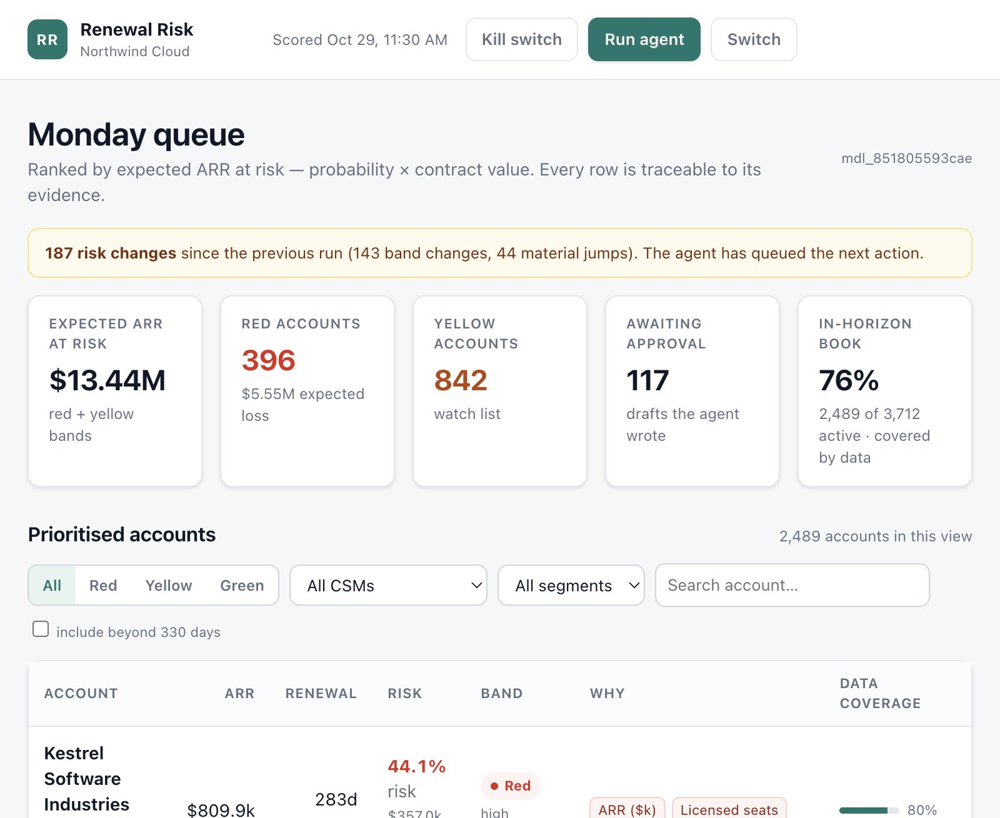
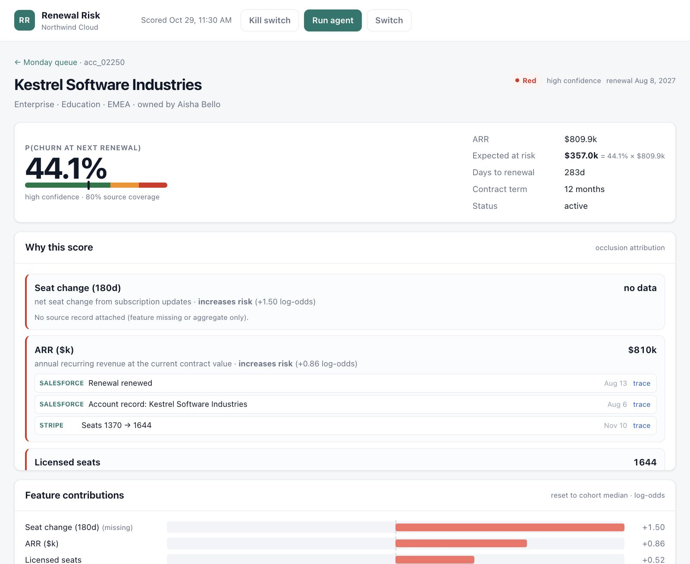
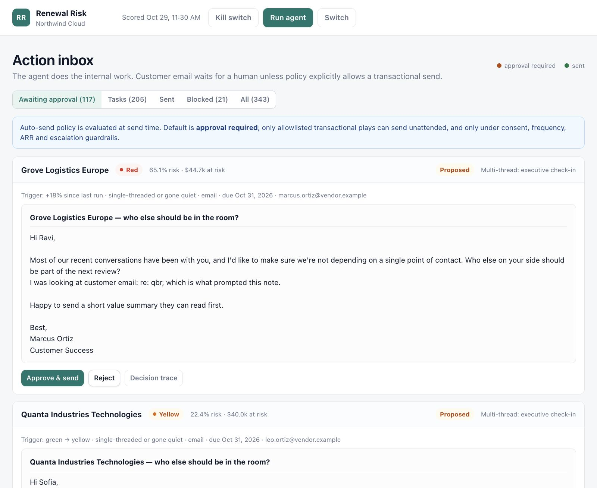
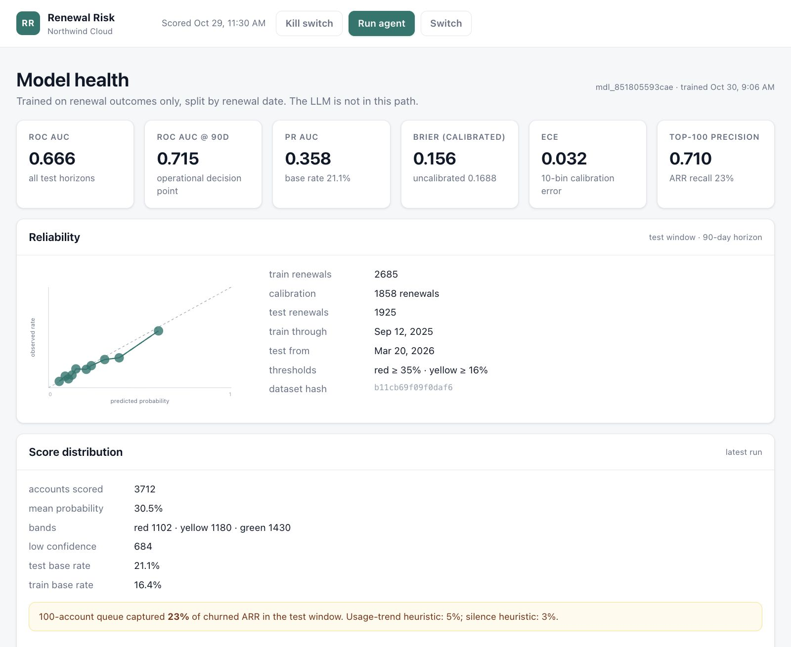
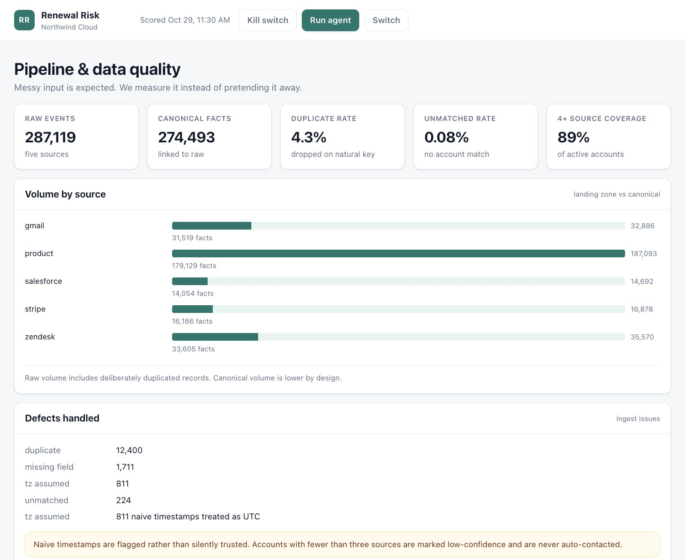
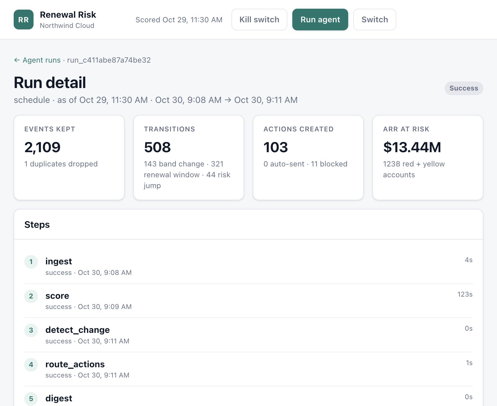

# Renewal Risk Workbench

A working, multi-tenant customer-success system that answers one question for a
CSM: **which conversations protect the most revenue this week, and what should I
do next?**

It ingests messy events from Salesforce, Stripe, Zendesk, Gmail and product
telemetry; fits and calibrates a churn model; ranks the book by expected ARR at
risk; explains each score with evidence; routes each account to a play; and
runs unattended on a schedule. Customer-facing email is approval-gated by
default, with a narrow transactional auto-send exception.

This repository is the deliverable for the VP Customer Success request. It is
deliberately **not** the requested "email every red account" system. The
[solution brief](docs/01-solution-brief.md) makes that argument; this README is
the operator's view.

---

## Quickstart

Requirements: Python 3.9+, ~1.5 GB free disk (the demo DB is ~0.5 GB).

```bash
cd customer-health-platform   # or the directory you unpacked
python3.9 -m venv .venv
.venv/bin/pip install -r requirements.txt

# Build the frozen demo world: 2 tenants, ~313k raw events, 2 models, first run.
# Takes about 4 minutes. Use --fresh to rebuild from scratch.
.venv/bin/python scripts/bootstrap.py --fresh

# Start the API + console. The scheduler is on by default; for the frozen
# demo we pin it off so the displayed run stays at the intended as-of.
# Advance the world with scripts/nightly.py --as-of … instead.
CHP_SCHEDULER=0 .venv/bin/uvicorn app.main:app --host 127.0.0.1 --port 8000
```

Open <http://127.0.0.1:8000>. API docs: <http://127.0.0.1:8000/docs>.

### Demo tenants

| Workspace | Tenant ID | API key | Accounts | Auto-send |
|---|---|---|---:|---|
| Northwind Cloud | `tnt_northwind` | `chp_demo_northwind_2f8a` | 5,000 | off (approval required) |
| Lumen Analytics | `tnt_lumen` | `chp_demo_lumen_9c14` | 600 | transactional only |

The login screen lists both. The key is presented as a bearer token and hashed
to a tenant; the plaintext key is never stored in the database.

### Screens

| | |
|---|---|
|  |  |
|  |  |
|  |  |

Also: [workspace picker](docs/screenshots/login.jpg) and
[run list](docs/screenshots/runs.jpg). Captured from the running demo at 2×
pixel density.

Prefer motion? [docs/walkthrough.mp4](docs/walkthrough.mp4) is a 4-minute
narrated walkthrough assembled from these screens and the deck, generated by
`scripts/make_walkthrough.py`.

### Useful commands

```bash
# Unattended run for all tenants (cron/launchd entry point).
.venv/bin/python scripts/nightly.py --as-of 2026-10-29T06:00:00+00:00

# Rebuild the solution brief deck from the live model metrics.
.venv/bin/python scripts/make_deck.py

# Rebuild the narrated walkthrough (macOS say + ffmpeg).
.venv/bin/python scripts/make_walkthrough.py

# Tests. They build a small isolated world, so they do not touch data/chp.db.
PYTHONPATH=. .venv/bin/pytest -q
```

---

## What the system does

1. **Ingests five sources into an immutable landing zone.** Raw payloads keep
   their source shape. Duplicates, naive timezones, missing fields, orphaned
   events and late arrivals are recorded, not silently repaired.
2. **Canonicalises into typed facts.** Identity resolves by domain → contact
   email → fuzzy name. Every fact keeps `raw_event_id`, `occurred_at`, and
   `arrived_at`.
3. **Builds point-in-time features.** 44 signals across commercial, usage,
   support, relationship, billing, and data coverage. A run at `as_of` sees
   only events that both happened and arrived by then.
4. **Scores with a fitted model.** `P(churn at next renewal)` from a
   gradient-boosted classifier and an isotonic calibrator. Not an LLM.
5. **Ranks the queue** by `prob × ARR`, bounded by the tenant's CSM capacity.
   Red/yellow/green is a glanceable band; the ranking is expected revenue.
6. **Explains each score** with the top reason codes, the feature values, the
   raw evidence, and a data-coverage confidence label.
7. **Routes to a play** (billing recovery, escalation review, executive
   check-in, adoption rescue, re-engagement, renewal review, expansion review)
   and drafts a task or email from deterministic templates.
8. **Runs unattended.** A scheduler calls the same `run_agent` as the CLI:
   ingest → score → detect change → route/policy/act → digest. Failures are
   recorded in `agent_runs` and do not kill the loop.
9. **Gates external communication.** Consent, coverage and the kill switch are
   hard blocks. Everything else (ARR ceiling, caps, cooldown, open P1,
   non-transactional play) forces a human approval.

## Architecture

```
Salesforce  Stripe  Zendesk  Gmail  Product
     │         │        │       │       │
     └─────────┴────────┴───────┴───────┘
                       ▼
              raw_events (immutable, arrived_at)
                       ▼  canonicalize (dedupe, resolve, PIT)
                    facts ──────────────▶ renewals
                       ▼
            point-in-time feature panel
                       ▼
        model_versions ──▶ scores ──▶ score_features
                       ▼
              agent_runs / agent_steps
                       ▼
          actions ──▶ policy decision ──▶ outbox
             │                              │
             └──── action_events ───────────┴──▶ audit_log
                       ▼
              CSM console / API
```

Key boundaries:

- **API** (`app/api/routes.py`): tenant from the bearer key, never the URL.
- **Agent** (`app/agent/`): loop, plays, policy. No UI code.
- **Model** (`app/model/`): training, scoring, evaluation, artifacts.
- **Features** (`app/features/`): one registry drives training, serving and UI.
- **Ingest** (`app/ingest/`): generator and canonicaliser.
- **Web** (`app/web/`): vanilla HTML/CSS/JS, no build step.

Full table and field reference: [docs/data-dictionary.md](docs/data-dictionary.md).

---

## The model

**Target:** churn at the next renewal (full churn, not downgrade).

**Training rows:** one row per `(settled renewal, monthly snapshot 30–330 days
before it)`. Downgrades are excluded from v1 training and counted separately in
the model card.

**Split:** by renewal date, 60% train / 20% calibration / 20% test. Snapshots of
the same renewal can never straddle the boundary.

**Model:** `HistGradientBoostingClassifier` (400 iterations, learning rate 0.05,
31 leaves, L2 1.5), sample-weighted toward near-renewal snapshots, then
isotonic calibration on the held-out time window.

**Bands:** red ≥ `max(0.35, 2 × train base rate)`, yellow ≥ `max(0.16, train
base rate)`. Thresholds are stored in the model artifact and repeated in every
score's `reason_json`, so a band can be audited after the fact.

**Explanations:** occlusion attribution — reset one feature to its training
median, measure the change in log-odds. It is model-agnostic and cheap enough
to batch. It is **not** a Shapley value, and the UI labels it "approximate".

Metrics for the current build are on the **Model** screen and in
[docs/model-card.md](docs/model-card.md). The headline numbers from the demo
build:

| Metric | Northwind (5,000 accounts) | Lumen (600) |
|---|---:|---:|
| Training rows / renewals | 55,876 rows / 2,685 train renewals | 3,688 / 265 |
| ROC-AUC (test) | 0.666 | 0.675 |
| AUC @ 90 days | 0.715 | 0.764 |
| PR-AUC (test) | 0.358 | 0.327 |
| Brier score | 0.156 | 0.145 |
| ECE | 0.032 | 0.066 |
| Top-100 precision @ 90d | 0.71 (baseline 0.26) | 0.36 (k=22; baseline 0.09) |
| Red / yellow / green in horizon | 396 / 842 / 1,251 | 58 / 63 / 141 |
| Expected ARR at risk (red + yellow) | $13.44M | $2.03M |

The latest Thursday run ingested 2,109 late Northwind events and 287 late
Lumen events. The model's top features are engaged contacts, 180-day seat
utilisation, current utilisation, seat change, renewal proximity, and days
since the customer replied — which is what a CSM would check by hand, if they
had the time.

The model is intentionally not an LLM. It is reproducible from an artifact,
calibratable, temporally validatable, and stable when a model provider changes.
LLM prose can be added later, but it is not the source of truth.

## The queue

- `expected_arr_at_risk_cents = round(prob × arr_cents)`.
- Ranked by expected ARR at risk, then probability.
- Bounded by `queue_capacity` per tenant (120 Northwind, 60 Lumen), then
  transition-triggered accounts are unioned in up to 2× capacity.
- Default view hides renewals more than 330 days out; `include_outside_horizon`
  shows them.
- `coverage` is the share of the five sources seen in 180 days. Below the
  tenant minimum (`0.45`), email is hard-blocked.
- `confidence` is high (coverage ≥ 0.8 and fresh ≤ 21 days), medium
  (coverage ≥ 0.5), or low. It is a presentation label, not a second model.

## The agent loop and policy

`run_agent(conn, tenant, trigger, as_of)` records five steps:
`ingest → score → detect_change → route_actions → digest`.

**Triggers:** first score, band change, risk jump ≥ `risk_jump_threshold`,
renewal within 90 days. A stable red account is rescored nightly but not
re-actioned until the cooldown or a transition.

**Idempotency:**

- The same `(tenant, as_of, trigger)` is a no-op that returns the original run.
- Actions are keyed `(tenant, account, play, ISO week)`; a later run in the same
  week cannot double-send the same play.
- One open action per account per cooldown (7 days Northwind, 14 Lumen),
  whatever the play. A re-derived action on an existing account is recorded as
  a `retriggered` event, not a second email.

**Policy semantics** (`app/agent/policies.py`):

| Rule | If it fails |
|---|---|
| Kill switch | **Hard block** — nothing sends |
| Email consent / opt-out | **Hard block** |
| Source coverage < tenant minimum | **Hard block** |
| ARR above auto-send ceiling | Forces approval |
| Cooldown since last send | Forces approval |
| Daily / monthly cap | Forces approval |
| Open P1 incident in last 30 days | Forces approval |
| Non-transactional play | Forces approval |
| Transactional allowlist + all clear | May auto-send (if tenant enables it) |

Internal tasks are never gated by outreach rules; only the kill switch stops
them. Every decision writes a rule-by-rule trace to `actions.policy_json` and,
for sends, `outbox.meta_json.policy_trace`.

**Sends default to a simulated provider.** `outbox.provider = 'simulated'` and a
deterministic provider message ID are recorded, so no real email leaves the
machine unless you opt in. To deliver through a relay, set
`CHP_EMAIL_TRANSPORT=smtp` plus `CHP_SMTP_HOST`, `CHP_SMTP_PORT`,
`CHP_SMTP_USER`, `CHP_SMTP_PASSWORD`, `CHP_SMTP_FROM`, and `CHP_SMTP_TLS`
(`starttls` by default, `ssl` or `none` for a local sink). The outbox then
records `provider='smtp'` and the real `Message-ID`. The demo is never
configured to send, and delivery happens only after the policy gate passes.

## Multi-tenancy

- `Authorization: Bearer <key>` → SHA-256 lookup → exactly one tenant.
- Tenant identity is never accepted from a path, query, or body.
- Every tenant-owned table has `tenant_id`; every API query filters on it.
- The test suite seeds the **same account ID** in two tenants and asserts that
  each lookup returns its own row; a fact or raw ID from another tenant is a
  404.
- `/api/demo/tenants` exposes only slugs, names, keys, and account counts; it
  never returns key hashes.
- The scheduler loops tenants independently. A failure in one is recorded and
  does not stop the others.

## Traceability

Every CSM-visible number resolves downward:

```
queue row → scores.prob / band / expected_arr_at_risk_cents
          → model_versions.id (artifact, dataset hash, metrics)
          → score_features (44 values, imputation flags, contributions)
          → facts (source record, occurred_at, arrived_at)
          → raw_events (immutable payload, natural key, batch)
```

Useful endpoints:

```bash
KEY=chp_demo_northwind_2f8a
curl -s -H "Authorization: Bearer $KEY" http://127.0.0.1:8000/api/digest
curl -s -H "Authorization: Bearer $KEY" http://127.0.0.1:8000/api/queue?limit=5
curl -s -H "Authorization: Bearer $KEY" http://127.0.0.1:8000/api/accounts/acc_00001
curl -s -H "Authorization: Bearer $KEY" http://127.0.0.1:8000/api/lineage/fact/<fact_id>
```

`tests/test_traceability.py` recomputes a feature vector from raw facts and
asserts it matches the stored score, then walks fact → raw event and checks the
same identifiers are invisible to the other tenant.

## Decisions

The full list, with rejected alternatives, is in
[docs/decisions.md](docs/decisions.md). The short version:

- Workbench, not auto-emailer; automate internal work, gate external comms.
- Narrow hard blocks; guardrails force approval rather than silently refusing.
- Fitted tree model + isotonic calibration, no LLM in the scoring path.
- Split by renewal date; monthly pre-renewal snapshots.
- Point-in-time enforced in SQL (`occurred_at` **and** `arrived_at`).
- SQLite for the demo, with explicit tenant keys and set-based queries.
- Edge-triggered actions, one per account per cooldown.
- Frozen demo world; late data arrives as a second batch.
- Deterministic draft templates; LLM prose optional and out of the critical path.

## Deliberate skips (v1)

- No causal uplift model. The value estimate uses a stated assumption (12%
  relative save lift, $400 intervention cost), not a measured effect.
- No expansion scoring. `expansion_review` is a routing rule, not a model.
- No meeting notes, call transcripts, or LLM sentiment. Ticket sentiment is a
  deterministic lexicon.
- No automated retraining or drift remediation. Retraining is a CLI operation;
  drift is reported, not acted on.
- No ESP webhooks, bounce/complaint processing, or SMS. SMTP transport is
  available but not configured in the demo; no CRM write-back and no SSO.
- No live desktop capture. The environment cannot record a screen; the
  [narrated walkthrough](docs/walkthrough.mp4) is assembled from the live
  screenshots and the recording script, and the script remains the source for a
  human one-take recording.

## What breaks first at 10×

Target: 50,000 accounts, ~3.1M raw events, same CSM headcount (10× the demo).

1. **SQLite nightly full recompute.** The score step is already ~120s for 3,700
   active accounts because explanations are per-feature. At 10× this is roughly
   20 minutes of single-process CPU, and WAL write contention with the API
   becomes visible.
2. **Per-account occlusion explanations.** 44 model calls per account, so 10×
   the book is ~1.6M extra model calls per night. The fix is batch/vectorised
   attribution (or SHAP on a sample plus cache), not a bigger box.
3. **Queue aggregation without partitioning.** `SUM(expected_arr_at_risk)` over
   the whole book on every page load. Partition by CSM pod and pre-aggregate
   the digest per run.
4. **Single-process scheduler.** Per-tenant locks are in memory. Move to a
   durable queue with one worker per tenant and idempotent jobs.
5. **Raw event volume.** The immutable landing zone grows without bound. Add
   object storage + Parquet and retention tiers before touching the model.

Migration order: feature aggregates (event-time stream + materialised
windows) → columnar store for facts/features → batched explanations → queue
partitioning. The API contract and tenant scoping survive the move; the SQLite
helpers are the seam.

## Tests

```bash
PYTHONPATH=. .venv/bin/pytest -q
# 39 passed
```

The suite builds a smaller tenant through the **same** generator, ETL, training
and agent code paths, then asserts:

- **Point-in-time:** no fact arrived after the run cut-off; held-back events
  are ingested by a later run; scores are bounded by their `as_of`.
- **Tenant isolation:** missing key is 401; a key resolves to one tenant; an
  account ID shared across tenants returns each tenant's row; queue is scoped.
- **Policy:** default is approval; ARR ceiling forces approval but not a hard
  block; transactional allowlist can auto-send; non-transactional cannot;
  missing consent and kill switch are hard blocks; internal tasks are not gated.
- **Idempotency:** same window is a no-op; re-canonicalising adds nothing;
  a second run in the same week does not give an account a second action; keys
  are unique and the DB rejects duplicates.
- **Model/traceability:** split by renewal date, horizon bounds, artifact
  versioning, calibration monotonicity, feature hash reproduction, expected
  ARR arithmetic, digest arithmetic, fact → raw lineage, approval → outbox +
  audit + events.
- **Delivery:** simulated by default; SMTP transport delivers a real message to
  an in-process SMTP sink and records the provider `Message-ID`; a missing
  host fails instead of silently dropping the send, and a failed send rolls
  back the approval so the action stays proposed.

## Repository layout

```
app/
  agent/        runner, plays, policies
  api/          FastAPI routes (tenant-scoped)
  features/     registry, point-in-time builder
  ingest/       synthetic generator, canonicaliser
  model/        train, score/attribute, evaluate
  web/          console (vanilla HTML/CSS/JS)
  schema.sql    SQLite schema
scripts/
  bootstrap.py  build world end to end
  nightly.py    unattended run (cron)
  make_deck.py  generate the solution-brief PPTX
  make_walkthrough.py  narrated MP4 from screenshots + script
tests/
docs/
  01-solution-brief.md
  model-card.md
  data-dictionary.md
  decisions.md
  walkthrough-script.md
  walkthrough.mp4
  solution-brief.pptx
```

## Known limitations

- The generator is synthetic. The model's numbers are a demonstration of
  method, not evidence about a real book.
- ARR is stored in cents as an integer; currency is assumed USD.
- `days_to_renewal` is clipped to `[-30, 330]` at serving time so an account
  just past renewal is still scored rather than producing a huge negative.
- Downgrades are excluded from the v1 target and reported separately.
- The "value" estimate in the model card is an assumption, not a causal claim.
- Auto-send is disabled for Northwind by policy. Lumen's auto-send exists to
  exercise the guardrail path, not as a recommendation.

## Docs

- [Solution brief](docs/01-solution-brief.md) — the one-page argument.
- [Model card](docs/model-card.md) — target, data, metrics, calibration,
  limitations, ethical/operational notes.
- [Data dictionary](docs/data-dictionary.md) — every table, field, source
  mapping, identity rule, and time semantic.
- [Decisions](docs/decisions.md) — 11 decisions, rejected alternatives, and
  deliberate skips.
- [Walkthrough script](docs/walkthrough-script.md) — 5–7 minute recording script.
- [Narrated walkthrough](docs/walkthrough.mp4) — 4-minute MP4 built from the
  screenshots and deck; regenerate with `scripts/make_walkthrough.py`.
- [Solution brief deck](docs/solution-brief.pptx) — generated from live metrics.
